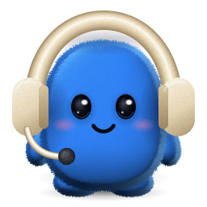
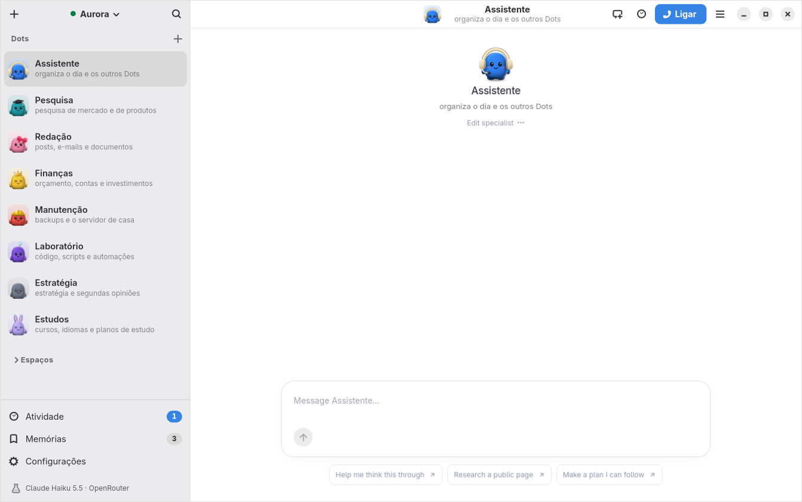

<div align="center">



# Dotdeck

**Seus colegas de IA do OpenDots no desktop Linux.**

Cliente nativo (GTK 4 + Libadwaita) para servidores [OpenDots](https://github.com/CopilotKit/OpenDots):
conecte-se ao seu servidor no próprio computador, na rede de casa, pelo Tailscale ou na nuvem.

**[Site oficial](https://euvinicios.github.io/Dotdeck/)** ·
**[Snap Store](https://snapcraft.io/dotdeck)** ·
**[Baixar](https://github.com/EuVinicios/Dotdeck/releases/latest)** ·
**[Relatar um problema](https://github.com/EuVinicios/Dotdeck/issues)** ·
**[English](#english)**

[](https://euvinicios.github.io/Dotdeck/)
[](https://snapcraft.io/dotdeck)
[](https://github.com/EuVinicios/Dotdeck/actions/workflows/ci.yml)
[](https://github.com/EuVinicios/Dotdeck/actions/workflows/snap.yml)
[](LICENSE)



</div>

## Recursos

- **Barra lateral nativa com todos os Dots**: cada Dot aparece com o seu pet, o nome e a
  função, no estilo do Grok Bot. Logo abaixo ficam os Espaços, e no rodapé Atividade,
  Memórias, Configurações e o modelo que os Dots estão usando. Você pode buscar (`Ctrl+K`),
  fixar e ocultar Dots, e trocar de Dot com `Ctrl+1…9` ou `Alt+↑/↓`. A página do OpenDots
  aparece limpa, sem a barra dela.
- **12 pets de pelúcia**, um diferente para cada Dot, escolhidos pela função. Dá para trocar
  na galeria, e o mesmo pet aparece na conversa e na chamada.
- **Configurações avançadas** com seções e busca:
  - Aparência e densidade
  - Notificações por evento
  - Editor completo de cada Dot
  - Voz e microfone, com teste de nível
  - Modelos de IA: provedor (OpenRouter, Anthropic com chave de API ou compatível com
    OpenAI), uma chave por provedor, custo aproximado, teste do modelo e os três modelos de
    uma chamada de voz
  - Servidores, privacidade e diagnóstico
- **Ligar para um Dot** com um clique (ou `Ctrl+Shift+L`), com o tempo da chamada na barra.
- **Configuração guiada**: digite `localhost:4310`, um IP da rede ou um nome do Tailscale. O
  Dotdeck testa a conexão, tenta `https`/`http` e a porta 4310 sozinho e explica o que falta
  (token, servidor só local, certificado inválido).
- **Vários servidores** (Homelab, Trabalho, Local…), cada um com o próprio acesso, cookies e
  dados. Troca rápida pela barra de título ou com `Alt+1…9`.
- **Token no chaveiro do sistema** (Secret Service / portal Secret no Flatpak), nunca em texto
  puro. Se você desbloquear a página com outro token, o Dotdeck confere e guarda.
- **Chamadas de voz com os Dots**. O WebKitGTK das distribuições e da Flathub não tem WebRTC,
  então o Dotdeck faz a chamada de forma nativa com o GStreamer (PipeWire/PulseAudio), com
  cancelamento de eco, botão de mudo na barra de título e aperte-para-falar global.
- **Notificações** quando um Dot conclui ou falha uma tarefa e quando uma tarefa agendada
  começa, mesmo com a janela fechada.
- **Bandeja e segundo plano**: ícone com status (Dots, tarefas rodando, chamada), "Falar com
  o Chefe", troca de servidor. No GNOME sem bandeja, aparece em *Aplicativos em segundo plano*.
- **Atualizar o servidor com um botão**: o Dotdeck avisa quando sai novidade no OpenDots
  oficial e atualiza mantendo as suas mudanças, desfazendo sozinho se algo falhar
  ([`server/`](server/README.md)).
- **Voz só com a chave do OpenRouter**: a ponte de voz do servidor usa o `gpt-audio-mini`
  (~US$ 0,005 por minuto de fala), sem conta na OpenAI.
- **Atalhos globais** pelo portal do sistema: `Super+Shift+D` mostra/oculta o Dotdeck,
  `Super+Shift+M` silencia o microfone, e um atalho de aperte-para-falar.
- **Tema claro/escuro** seguindo o sistema (também dentro da página), zoom, tela cheia.
- **Seguro por padrão**: a janela só navega na origem do servidor; qualquer outro link abre no
  navegador. O token e a ponte de voz só existem para a página do próprio servidor.

## Instalação

| Onde | Como |
|---|---|
| **Central de Aplicativos do Ubuntu** | procure por *Dotdeck* (Snap Store) ou `sudo snap install dotdeck` |
| **Ubuntu 26.04+ (.deb)** | `sudo apt install ./dotdeck_*_all.deb` (página de [releases](https://github.com/EuVinicios/Dotdeck/releases)) |
| **Outras distribuições (Flatpak)** | `flatpak install --user ./Dotdeck.flatpak` |

No snap, duas permissões ainda precisam ser ligadas à mão até a loja liberar a conexão
automática:

```bash
sudo snap connect dotdeck:audio-record
```

```bash
sudo snap connect dotdeck:password-manager-service
```

## Desenvolvimento

O código é Python 3 + PyGObject. A forma mais simples de ter o WebKitGTK 6, a Libadwaita e o
GStreamer certos é a SDK do GNOME 51:

```bash
flatpak install --user flathub org.gnome.Sdk//51 org.flatpak.Builder
```

| Tarefa | Comando |
|---|---|
| Rodar do código | `make run` |
| Testes (unitários, WebKit, voz, bandeja) | `make test` |
| Teste de fumaça da interface | `make smoke` |
| Validar .desktop e AppStream | `make validate` |
| Gerar o ícone de pelúcia | `make icon` |
| Capturas de tela (Dots fictícios, pt_BR e inglês) | `make screenshots OPENDOTS_CLIENT=<OpenDots>/dist/client` |
| Imagens da Snap Store e do site | `make store-assets` |
| Site oficial (`website/`) | `make site` |
| Flatpak local | `make flatpak` |
| Pacote .deb | `make deb` |
| Snap | `make snap` |
| Atualizar traduções | `make pot` |

Diagnóstico rápido do sistema: `dotdeck --self-test` (versões, motor de voz, chaveiro, sandbox).

Arquitetura, decisões e o porquê de cada escolha estão em [`docs/DECISOES.md`](docs/DECISOES.md).
Publicação: [Central de Aplicativos do Ubuntu](docs/publicar-na-central-de-apps.md) (inclui como
atualizar as capturas, a ficha da loja e o site) e [Flathub](docs/publicar-na-flathub.md).

## English

Dotdeck is a native GTK 4 / Libadwaita desktop client for [OpenDots](https://github.com/CopilotKit/OpenDots)
servers: a native sidebar with every Dot (pet, name and job), twelve plush pets, an advanced
Settings window with search, one-click voice calls with your Dots, guided setup, several
servers, owner tokens in the keyring, native voice calls
(GStreamer WebRTC, because WebKitGTK ships without it), notifications, tray icon, background
mode and global shortcuts. Get it from the Ubuntu App Center (`snap install dotdeck`), as a
`.deb` or as a Flatpak from the releases page. Website (Portuguese):
<https://euvinicios.github.io/Dotdeck/>.

## Licença

Código: [GPL-3.0-or-later](LICENSE). Ícones: CC-BY-SA-4.0.

O Dotdeck é um projeto independente, sem vínculo nem aval da CopilotKit. O OpenDots é
distribuído pela CopilotKit sob a licença MIT.
